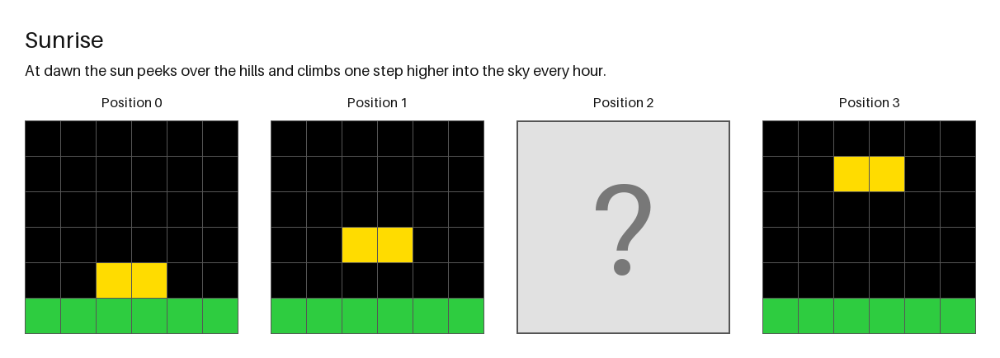
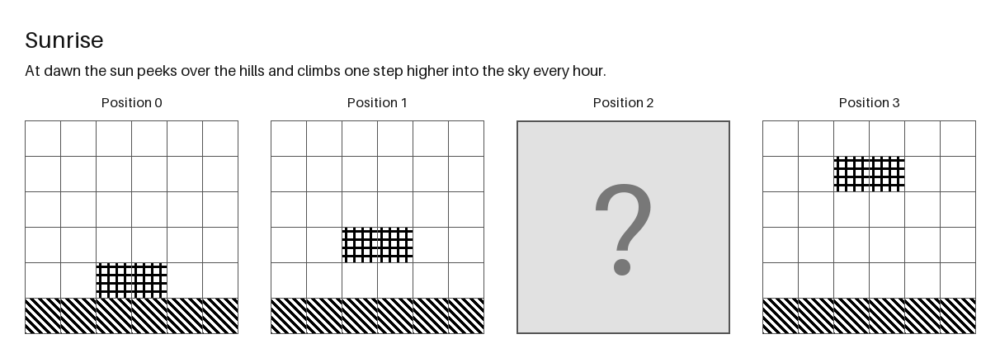
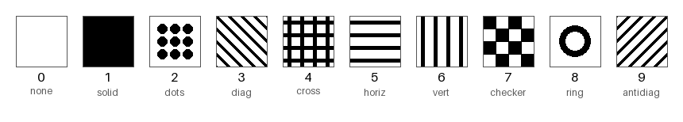
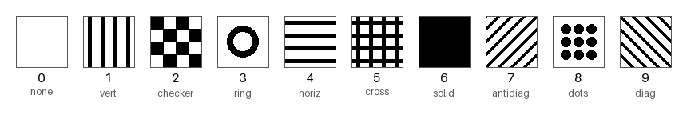

# NARC Eval

An [Inspect AI](https://inspect.aisi.org.uk/) evaluation that tests whether language models can solve **NARC puzzles**: ARC-style grid sequences paired with a short story that explains what changes from step to step. One or more grids in each sequence are hidden, and the model has to reconstruct them exactly.

The eval asks two questions:

1. **Does the narrative help?** The text task runs each puzzle with the grids and story together, the grids alone, or the story alone.
2. **Can models read the puzzle from an image?** The visual task renders each puzzle as a picture and gives it to a vision model. Grids can be drawn in the standard ARC colours, or in black-and-white patterns. The patterns separate "can the model see the grid" from "does the model depend on colour names".

<p align="center">
  
  
</p>
<p align="center"><em>The example puzzle in colour and in the <code>patterns_default</code> mapping. The model must produce the grid at Position 2.</em></p>

## How it works

| Step | File | What it does |
|---|---|---|
| Load | `utils.py` | Reads each puzzle JSON and builds the prompt for the chosen condition. Answer grids go into sample metadata and are never shown to the model. |
| Render | `render_puzzles.py` | Draws the title, story and grid sequence to PNG, with hidden positions shown as a grey `?` box of the right size. |
| Patterns | `mappings.py` | Defines which pattern stands for each cell value (0–9). Mappings are small JSON files, so new or shuffled ones are easy to make and reproduce. |
| Task | `tasks.py` | Two Inspect tasks: `narc_eval` (text) and `narc_eval_visual` (image). |
| Score | `scorers.py` | Exact match. It takes the last *N* JSON grids in the reply (one per hidden position), so working shown earlier in the reply is ignored. Reports accuracy and standard error. |
| Run | `run_eval.py` | Command-line runner that sweeps models × conditions or models × mappings at temperature 0. |

## Results

First runs on a private set of 25 puzzles with `qwen3.6-27b`, visual task, temperature 0:

| Rendering | Accuracy |
|---|---|
| ARC colours | 24% (6/25) ± 8.7% |
| Black-and-white patterns (`patterns_default`) | 4% (1/25) ± 4.0% |

Accuracy dropped sharply when colours were replaced with patterns, even though the prompt includes a legend for every pattern. This suggests the model leans on colour more than on reading the grid's structure. The sample is small, so treat these numbers as early signals.

## Setup

Requires Python 3.12+ and [uv](https://docs.astral.sh/uv/).

```bash
uv sync
cp .env.example .env   # then fill in your endpoint and key
```

The runner works with any OpenAI-compatible endpoint. I ran it against models hosted on MindRouter.

## Puzzle data

The puzzle set isn't included in this repo; only the pipeline is. To run the eval, put NARC puzzle JSON files in `narc-eval/data/`. [`narc-eval/examples/example_sunrise.json`](narc-eval/examples/example_sunrise.json) is a small made-up puzzle that shows the format:

- `sequence`: the grids in order. Hidden ones have `"masked": true` and `"grid": null`, but keep their `rows` and `cols`.
- `masked_positions`: the positions the model must fill in.
- `answer_grids`: the hidden grids, keyed by position. Only the scorer reads these.
- `title` and `narrative`: the story shown with the grids.

To try the pipeline without your own data, copy the example in: `mkdir -p narc-eval/data && cp narc-eval/examples/*.json narc-eval/data/`.

## Usage

```bash
# Text task: grids + story (default), or compare all three conditions
uv run narc-eval/run_eval.py text
uv run narc-eval/run_eval.py text --condition both grids_only narrative_only --limit 0

# Visual task: render images first, then run one pass per mapping
uv run narc-eval/render_puzzles.py --mapping colors patterns_default patterns_shuffle1
uv run narc-eval/run_eval.py visual --mapping colors patterns_default patterns_shuffle1 --limit 0

# Choose your own models
uv run narc-eval/run_eval.py visual --models openai/qwen/qwen3.6-27b

# Look through the results
uv run inspect view
```

`--limit` defaults to 5 puzzles per run for quick checks; `--limit 0` runs the full set.

### Pattern mappings

```bash
uv run narc-eval/mappings.py list                      # show saved mappings
uv run narc-eval/mappings.py shuffle my_map --seed 3   # random but reproducible mapping
uv run narc-eval/mappings.py preview my_map            # write a legend sheet to mappings/my_map.png
```

Built-in patterns: `none`, `solid`, `dots`, `diag`, `antidiag`, `cross`, `horiz`, `vert`, `checker`, `ring`. A mapping value can also be a path to a PNG tile. By default `shuffle` keeps 0 as blank so the background stays white.

| `patterns_default` | `patterns_shuffle1` |
|---|---|
|  |  |

## Project layout

```
narc-eval/
├── examples/            # a made-up example puzzle showing the JSON format
├── data/                # your puzzle JSON (not committed)
├── images/              # colour renderings (generated, not committed)
├── greyscale_images/    # pattern renderings, one folder per mapping (generated, not committed)
├── mappings/            # pattern mappings and their legend sheets
├── mappings.py
├── render_puzzles.py
├── run_eval.py
├── scorers.py
├── tasks.py
└── utils.py
```

## License

MIT. See [LICENSE](LICENSE).
